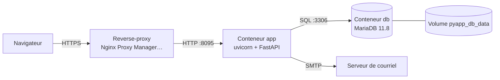

# 01 · Architecture

## Vue d'ensemble

| Conteneur | Image | Rôle | Port publié (défaut) |
|-----------|-------|------|----------------------|
| `pyapp_app` | construite depuis `docker/app/Dockerfile` (python:3.13-slim) | Application web, 2 processus uvicorn | `0.0.0.0:8095` → 8000 |
| `pyapp_db` | `mariadb:11.8` | Base de données | `127.0.0.1:3395` → 3306 (poste local uniquement) |

Sans Docker (Windows), la même application est lancée par `windows\start.bat` (`python -m app.serve`), avec SQLite :
voir [02 bis](02-deploiement-windows.md).

L'image s'exécute sous un utilisateur non root (`appuser`). Son healthcheck interroge `GET /health`, qui
exécute un `SELECT 1` en base.

## Organisation du code

| Dossier / fichier | Rôle |
|-------------------|------|
| `app/main.py` | `create_app()` : middlewares, routeurs, gestion des erreurs (401 → connexion, 403, 404, CSRF), page d'accueil, `/health` |
| `app/serve.py` | Lancement sans Docker (`python -m app.serve`) : migrations, puis uvicorn avec les réglages de `.env` |
| `app/config.py` | Classe `Settings` (pydantic-settings) : lit les variables d'environnement et `.env` |
| `app/db.py`, `app/models.py` | Moteur SQLAlchemy et tables |
| `app/web.py` | `render()` : contexte commun des gabarits, menu `NAV` filtré par permission, messages flash, filtres de date français |
| `app/core/sessions.py` | Sessions côté serveur (middleware) |
| `app/core/security.py` | En-têtes HTTP, CSP, jeton CSRF, IP du client, `safe_next()` |
| `app/core/passwords.py`, `totp.py` | Argon2id et politique de mot de passe ; TOTP et QR code |
| `app/core/permissions.py` | Catalogue des permissions et rôle protégé |
| `app/core/users.py` | Validation commune à la création d'un compte |
| `app/core/audit.py` | Écriture dans le journal d'audit et libellés des actions |
| `app/core/exports.py` | Exports CSV / XLSX |
| `app/core/mailer.py` | Envoi SMTP (ou écriture dans le journal sans SMTP) |
| `app/auth/` | `service.py` (logique pure, testable), `routes.py` (connexion, 2FA, mot de passe oublié), `setup.py` (première configuration) ; `deps.py` (utilisateur courant, `require_permission`) |
| `app/account/`, `app/admin/` | « Mon compte » et administration |
| `app/engine/` | **Moteur métier** : `core.py` (calcul, sans dépendance web) et `routes.py` (page + API) |
| `app/templates/`, `app/static/` | Gabarits Jinja2, CSS de la charte, `app.js`, police, logo |
| `migrations/` | Alembic (`0001_initial.py` crée le schéma et les rôles par défaut) |

## Cycle d'une requête

1. `SecurityHeadersMiddleware` ajoute les en-têtes (CSP, nosniff, HSTS en HTTPS, `Cache-Control: no-store`).
2. `ServerSessionMiddleware` lit le cookie `app_session`, charge la session depuis `web_sessions` (ou en crée
   une vide) et vérifie l'inactivité.
3. La dépendance globale `csrf_protect` refuse tout POST/PUT/PATCH/DELETE sans jeton valide (champ `csrf`
   ou en-tête `X-CSRF-Token`).
4. La route déclare `Depends(require_user)` ou `Depends(require_permission("…"))`. L'utilisateur est **relu en
   base à chaque requête** : un compte désactivé ou un rôle modifié s'applique aussitôt.
5. `render()` produit la page. En sortie, le middleware enregistre la session si elle a changé.

## Charte graphique

Reprise de *digitization_commercial* (`frontend/src/styles/tokens.css`, `shell.css`, `auth.css`,
`geo-background.css`, `icons.tsx`), transposée de React vers des gabarits Jinja2 et du CSS
simple :

| Élément | Valeur |
|---------|--------|
| Jaune (marque, bouton de connexion, élément actif du menu) | `--color-primary: #FBBC3A` |
| Teal (boutons principaux, liens, avatar) | `--color-secondary: #38AD9D` |
| Marine (titres, icônes, bandeau d'accueil) | `--color-navy: #27253C` |
| Logo | `app/static/img/logo.svg` (marque neutre à remplacer, sert aussi de favicon) |
| Police | Hanken Grotesk (servie localement, licence OFL dans `app/static/fonts/`) |
| Coque | Barre latérale vitrée 260 px sur ordinateur ; barre haute, tiroir et navigation basse sous 1024 px |

Règle reprise de *digitization_commercial* : utiliser les variables `var(--color-*)`, jamais de couleur
inventée, et pas de `style="…"` dans les gabarits (la CSP le bloquerait).
