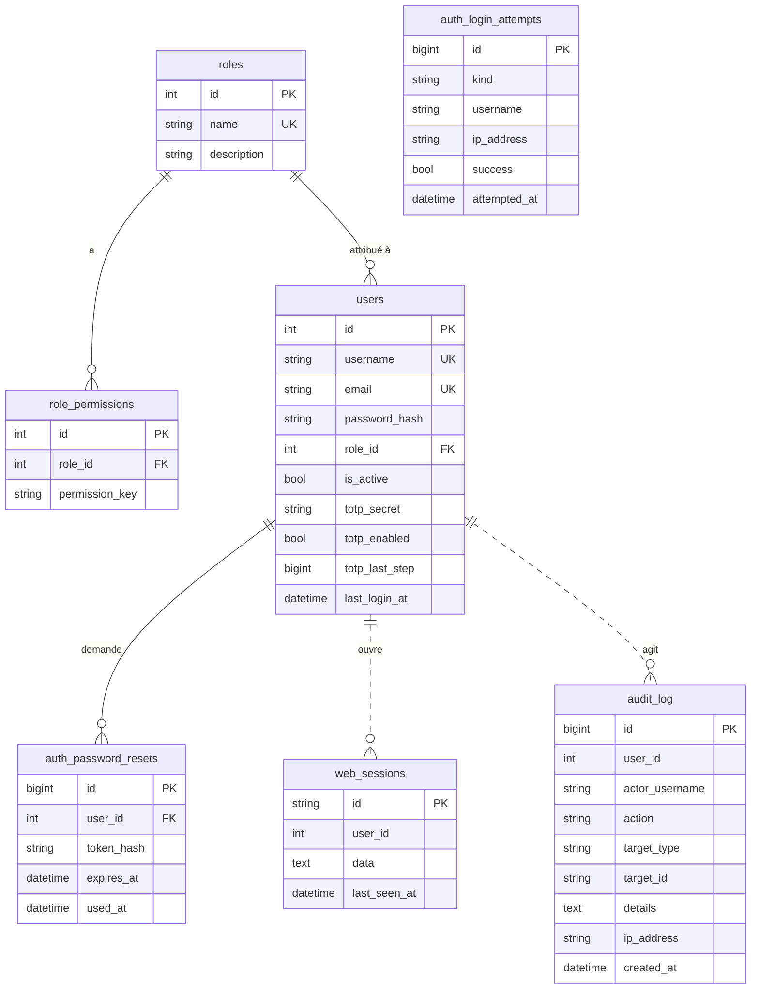

# 05 · Données

## Schéma

Les liens en pointillés ne sont pas des clés étrangères : une ligne du journal ou une session reste lisible
même après la suppression du compte.

## Rôle des tables

| Table | Contenu | Remarques |
|-------|---------|-----------|
| `roles` | Rôles : `admin` (Administrateur), `manager` (Responsable), `user` (Utilisateur) | Créés par la migration `0001`. `admin` ne peut pas être supprimé |
| `role_permissions` | Permissions de chaque rôle | Clés définies dans `app/core/permissions.py` |
| `users` | Comptes | Mot de passe haché en Argon2id ; `totp_last_step` empêche de rejouer un code 2FA |
| `auth_login_attempts` | Tentatives : `login`, `totp`, `reset_request`, `reset_fail` | Sert au verrouillage (fenêtre glissante). Peut être vidée sans risque |
| `auth_password_resets` | Codes de réinitialisation | Seule une empreinte HMAC-SHA256 du code est stockée |
| `audit_log` | Journal des actions sensibles | Purgé au-delà de `AUDIT_RETENTION_DAYS` |
| `web_sessions` | Sessions ouvertes | `id` = empreinte SHA-256 du jeton du cookie. Vider la table déconnecte tout le monde |
| `alembic_version` | Révision du schéma | Gérée par Alembic |

Toutes les dates sont stockées en **UTC** et affichées dans le fuseau `TIMEZONE`.

## Permissions par défaut

| Permission | Libellé | admin | manager | user |
|------------|---------|:-----:|:-------:|:----:|
| `admin.access` | Accéder à l'administration (page À propos) | ✔ (verrouillé) | | |
| `users.manage` | Gérer les utilisateurs | ✔ (verrouillé) | | |
| `roles.manage` | Gérer les rôles et permissions | ✔ (verrouillé) | | |
| `audit.view` | Consulter le journal d'audit | ✔ | ✔ | |
| `engine.run` | Utiliser le moteur de calcul | ✔ | ✔ | ✔ |

## Migrations

- Outil : Alembic, fichiers dans `migrations/versions/`.
- Appliquées automatiquement au démarrage du conteneur (`docker/app/entrypoint.sh`).
- Nouvelle table ou colonne : modifier `app/models.py`, puis
  `alembic revision --autogenerate -m "ajout table mesures"`. **Relire** le fichier généré : l'autogénération
  ne voit ni les renommages ni les données à reprendre.
- Ne jamais modifier une migration déjà appliquée en production : en créer une nouvelle.
